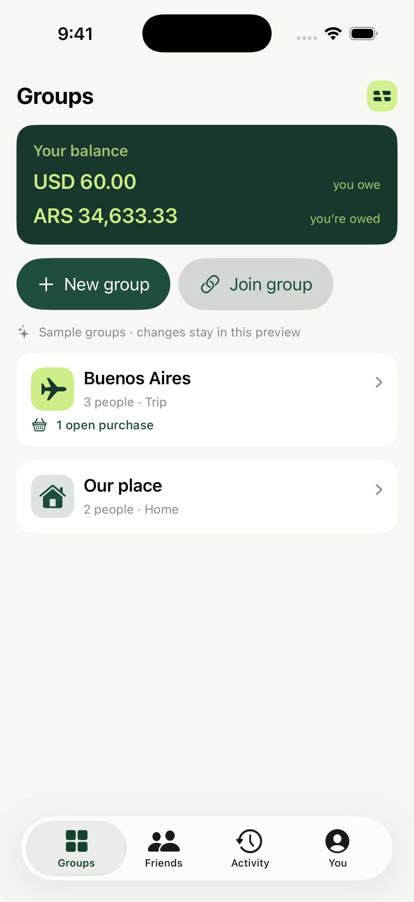
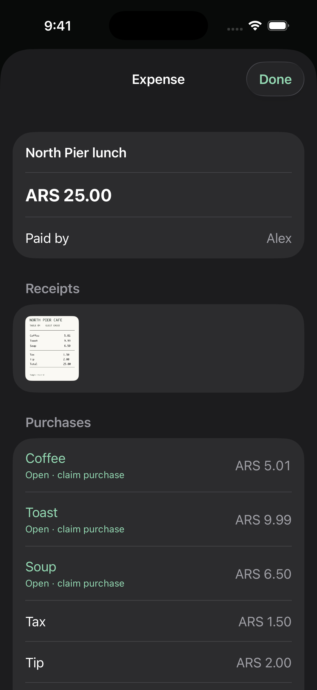

# Split by Yoink Labs

Split is a free iPhone and iPad app for tracking shared expenses. Start a trip, household, or two-person tab, record who paid, and see who owes whom. Each currency has its own balance.

[Join the TestFlight beta](https://testflight.apple.com/join/YX8W6bCx) · [Release and signing](docs/TESTFLIGHT.md) · [Simulator audit](docs/USABILITY.md) · [Screenshot gallery](screenshots/README.md)

<p>
  
  
</p>

## Using Split

- **Create or join.** Start a group on your own. Open **People → Create group invite** to share a link or copy a code. Multiple people can use it for seven days. Create a fresh invitation at any time. In **Groups → Join group**, paste either the code or the full link.
- **Add people.** Find a Split account by exact email or username. Name searches are limited to people with whom you already share a group. Select **Placeholder** to add someone by name, with optional email or phone. This works during group creation, from People, and while composing an expense.
- **Claim history.** Send a placeholder’s personal invite, or let the person sign in with the matching verified primary email. Split preserves earlier expenses and payments. If they already joined the group separately, both records resolve to one member. Phone numbers are optional contact information. They do not prove ownership.
- **Record an expense.** Tap **Add an expense**, enter the amount and save. The group currency, you as payer, and an equal split are preselected. Add a description or choose exact amounts, percentages, or shares. Tap a saved entry for the breakdown. Its author can edit an expense or delete an entry.
- **Read a receipt.** Add up to four photos from the library or camera. Vision suggests editable names, prices, tax and tip on the device. Review the suggestions, correct them or add items by hand. You can also keep photos on a regular split. Group members can tap a thumbnail to open the full-size receipt.
- **Claim purchases.** Open an item and select one person or several, including placeholders. The item’s price and proportional tax and tip are shared evenly. Unclaimed costs stay with the payer and appear in the open total. Tap the open-purchases filter in the group to find them. Pull to refresh for other people’s claims. The payer can close a receipt, distributing all remaining items to everyone or selected people. If the payer is a placeholder, the person who recorded the expense can close it.
- **Explore group spending.** Open **Balances** for totals in each currency, expand a category or month, or tap a person for expenses they paid or shared. Paid and share measure spending. Net includes recorded payments.
- **Settle up.** Balances suggest payments within each currency. Record a full or partial payment after money changes hands. Split records payments and does not transfer funds.
- **Use another device.** A Clerk session syncs your groups. **You → Connected computers** approves and revokes CLI/MCP access. The signed-out preview uses fictional data on the device.

Supported currencies are USD, ARS, EUR, GBP, BRL, CAD, AUD, and MXN. Amounts use integer minor units. Largest-remainder allocation preserves every cent.

## Architecture

| Component | Responsibility |
| --- | --- |
| [SwiftUI app](Split) | iOS 18+, system appearance and Dynamic Type, protected per-account cache, and FIFO outbox for new groups, expenses and payments |
| [Split Worker](worker/src/index.ts) | Authenticated ledger and membership API, invitation landing page, universal-link association and CLI/MCP routes |
| [D1 migrations](worker/migrations) | Groups, stable member IDs, private contact records, identity aliases, expenses, hashed invites, revisions via conditional updates, deletion tombstones, private receipt images and device credentials |
| Clerk | Existing Yoink Labs sign-in. The Worker verifies signed sessions with public JWKS and reads the signed-in user’s verified profile through the Clerk backend API |

New ledger records without photos can be entered offline. Photo uploads, full-size downloads and shared claims require a connection. The app compresses each photo to a JPEG of at most 240 KiB and strips original image metadata. Split stores photos in its existing D1 database, checks group membership on every download, and caps receipt bytes at 100 MiB across the service. Deleting an expense removes its photos. Search, adding someone to an existing group, joining, sharing invites, editing and deleting require connectivity. Snapshot refreshes retry when the app becomes active or connectivity returns. The beta supports 50 active people per group, 100 groups per account and 5,000 visible entries per account. Split uses its own Worker and D1 database on Cloudflare’s free tier.

## Local development

Use Xcode with an iOS 18+ simulator, XcodeGen, Node 22.18+ and npm. Install project dependencies and generate the Xcode project from the repository root.

```sh
npm ci --prefix worker
xcodegen generate
npm run typecheck --prefix worker
npm test --prefix worker
node --test cli/test/*.test.mjs
```

Open `Split.xcodeproj` and run the Split scheme. In ADE, use `ade apple launch --follow --text` and `ade apple test --scheme Split --text`. The sample preview is usable without signing in. The app normally connects to the production Split API.

For a local Worker, apply migrations to the local D1 store, then start Wrangler with the Clerk binding in the process environment. Run these commands from the root with the ADE project vault available.

```sh
npm run db:local --prefix worker
ade secrets exec --env CLERK_SECRET_KEY -- /opt/homebrew/bin/node worker/node_modules/wrangler/bin/wrangler.js dev --local --config worker/wrangler.jsonc --port 8787
```

Use the absolute path to your Node executable if it differs. Add `-splitLocalAPI` to the **Debug simulator** launch arguments to use loopback port 8787. Local ledger storage has its own cache and outbox. The local Worker verifies real Clerk sessions. The automated Worker tests use isolated D1 test data and a stubbed identity response.

On macOS file-provider volumes, Xcode may reject Finder metadata when signing a simulator bundle. Run `xcodebuild` with the same project, scheme and destination and the build setting `OTHER_CODE_SIGN_FLAGS=--strip-disallowed-xattrs`. This preserves normal signing and applies to dependency bundles as well.

## Configuration and deployment

| Name | Where it belongs |
| --- | --- |
| `CLERK_SECRET_KEY` | Split Worker secret and ADE vault. Used to read the authenticated user’s verified identity |
| `CLERK_ISSUER`, `APP_URL` | Public Worker configuration |
| `DB` | D1 binding to the database named `split` |
| `CLOUDFLARE_API_TOKEN`, `CLOUDFLARE_ACCOUNT_ID` | ADE deployment credentials |
| `SPLIT_TOKEN`, `SPLIT_API_URL` | Optional CLI environment settings |
| Clerk publishable key | Public client configuration in [SplitApp.swift](Split/SplitApp.swift) |

The current production route is `split-api.yoinklabs.dev`. Verify the `split-api` Worker name and `split` database in [wrangler.jsonc](worker/wrangler.jsonc) before deployment. Apply outstanding migrations, then deploy from a revision containing both the iOS ledger and CLI/MCP routes. The Clerk secret must already be provisioned on this Worker. Keep credentials in the vault.

```sh
ade secrets exec --env CLOUDFLARE_API_TOKEN --env CLOUDFLARE_ACCOUNT_ID -- /opt/homebrew/bin/node worker/node_modules/wrangler/bin/wrangler.js d1 migrations apply split --remote --config worker/wrangler.jsonc
ade secrets exec --env CLOUDFLARE_API_TOKEN --env CLOUDFLARE_ACCOUNT_ID -- /opt/homebrew/bin/node worker/node_modules/wrangler/bin/wrangler.js deploy --config worker/wrangler.jsonc
```

## License

This repository has no published open-source license. Contact Yoink Labs for reuse permission. Third-party dependencies retain their own licenses.

## CLI and MCP

Install the CLI and connect it to your Split account.

```sh
brew install yoink-labs/tap/split
split login
split groups list --json
```

Approve the code in **You → Connected computers** in the signed-in iPhone app. The same screen lists devices and revokes access. Scripts can provide `SPLIT_TOKEN` and `SPLIT_API_URL`. The CLI runs ledger commands on Split’s Worker.

For Claude Desktop or Cursor, add this entry to your MCP configuration. Use the path reported by `command -v split`.

```json
{"mcpServers":{"split":{"command":"/opt/homebrew/bin/split","args":["mcp"]}}}
```

For Codex, add this to `~/.codex/config.toml`.

```toml
[mcp_servers.split]
command = "/opt/homebrew/bin/split"
args = ["mcp"]
```

Remote MCP clients can use Streamable HTTP at `https://split-api.yoinklabs.dev/mcp` with a device bearer token. See the [CLI and MCP guide](cli/README.md) for receipt photos, open purchases, spending breakdowns, expense splits, placeholder invitations, lookup, confirmation previews and remote client configuration.
