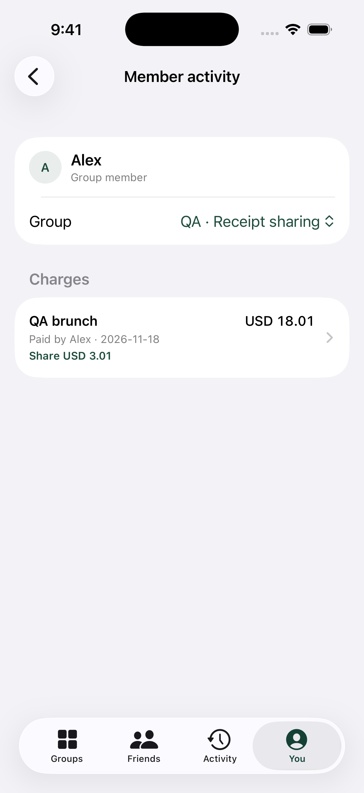
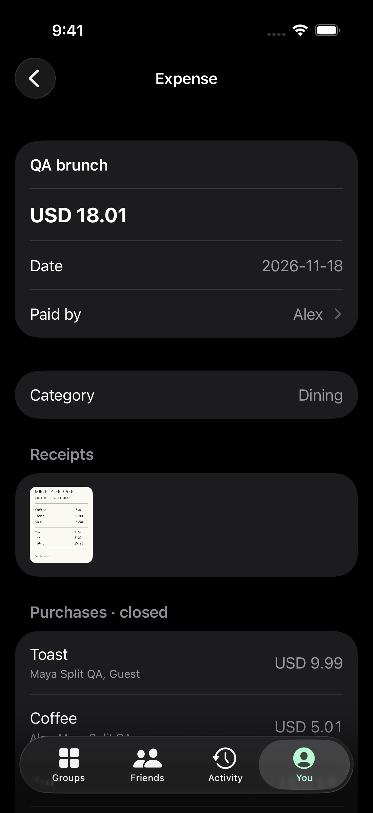
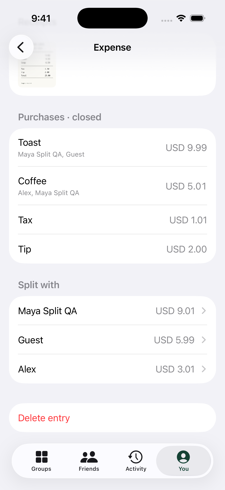
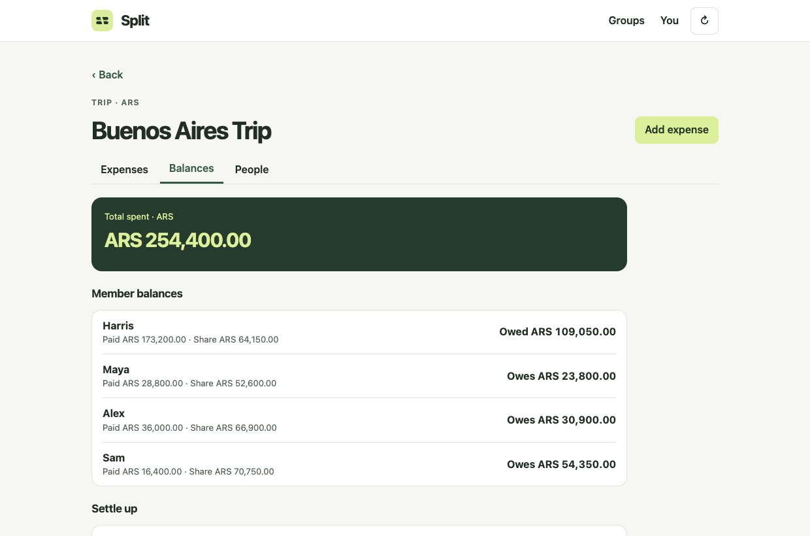
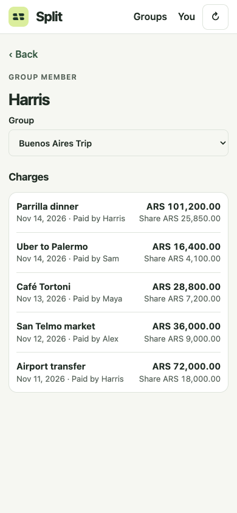

# Split

Split expenses

[](LICENSE)

Split is a free web, iPhone, iPad and iPhone Duo app for tracking shared
expenses. Start a trip, household, or two-person tab, record who paid, and see
who owes whom. Groups can settle in one currency using historical or manual
rates. Open source under MIT.

It is also a complete, no-paywall take on the Splitwise experience: a dashboard
across every group, friends and one-to-one tabs, itemized receipts, comments and
likes, search, charts, multi-currency settlement, member statements and a full
activity feed. Every feature Splitwise puts behind Pro is free here.

The iOS app is native SwiftUI, not an Ionic or web-wrapper project. It builds
against the iOS 27.2 SDK with an iOS 18 deployment target and adopts the iPhone
Duo layouts through standard SwiftUI containers: a system tab bar that moves to
the vertical axis on the inner display, `NavigationSplitView` list/detail
screens, and adaptive grids that grow from one to two columns with the available
width. The web client shares the same Worker, groups and cent allocations.

[Join the TestFlight beta](https://testflight.apple.com/join/YX8W6bCx) · [Contribute](#contributing) · [Roadmap](ROADMAP.md) · [Changelog](CHANGELOG.md) · [Release and signing](docs/TESTFLIGHT.md) · [Simulator audit](docs/USABILITY.md) · [Screenshot gallery](screenshots/README.md)

<p>
  
  
  
</p>

## What’s new in 0.8

- **Import from Splitwise.** Export each group from Splitwise (group → settings
  gear → **Export as spreadsheet**; in the app, the **Export** button at the end
  of the group's header menu) and pick one or several CSVs. Split previews each
  group, lets you match names to yourself, existing members or placeholders,
  and confirms the balances equal Splitwise's own **Total balance** rows to the
  cent before anything is saved. [How it works](docs/SPLITWISE_IMPORT.md)
- **Free currency conversion.** Choose your **Home currency** in Account to see
  expenses, receipts, spending and balances in one currency. Foreign expenses
  use a saved rate or a published historical rate when available. Open balances
  use recent rates. Expense details and settle-up show the original currency
  so you can confirm what was charged or paid.

## What’s new in 0.7

- **Member statements.** Tap **You** or any group member to see their charges
  across shared groups. A person with several groups gets a picker, and the
  Split with rows on a charge open another member directly.
- **Home dashboard.** Per-currency totals for what you owe and are owed, every
  open balance by person, group cards, recent activity and a shareable balance
  reminder. Nothing is hidden behind an upgrade screen.
- **Groups and friends.** Groups use a list/detail layout on iPad and iPhone Duo
  and collapse to a stack on a folded phone. Friends combine balances from every
  shared group and can start a one-to-one tab without creating a visible group.
- **A complete expense composer.** Multiple payers, notes, categories, the date,
  receipt photos and itemized claims, plus five split modes: equally, exact
  amounts, percentages, shares and equal-with-adjustments.
- **Social ledger.** Comments and likes on every expense, with author-only
  deletion, month-grouped activity, group and type filters.
- **Free Pro features.** Global search across groups, people and expenses, and
  Analytics charts for time, category, person and currency.
- **iPhone Duo.** The tab bar moves to the 84 pt vertical bar on the inner
  display, group and friend lists become two-pane, and the dashboard uses an
  adaptive grid across folds, Split View and every orientation.
- **A living surface.** Warm paper and evergreen ink, a slowly drifting aurora
  background, Liquid Glass cards and controls on iOS 26+, and compact action
  clusters instead of full-width buttons. Light, dark, Dynamic Type and Reduce
  Motion are all first-class.
- **A web client.** The same groups, expenses, receipts and member statements
  are available in the browser at `split.yoinklabs.dev`.

## Using Split

- **Create or join.** Start a group on your own. Open **Members → Invitations** to share a link or copy a code. Multiple people can use it for seven days. Create a fresh invitation at any time. In **Groups → Join group**, paste either the code or the full link.
- **Friends and people settings.** Send friend requests by full sign-in email or to someone in a shared group. Manage accepted friends and link a group placeholder to an account you know. [Privacy and history details](docs/PEOPLE_SEARCH.md)
- **Invitations inbox.** Open **Invitations** (web sidebar, or the tray in Groups on iOS) to accept or decline pending invitations. These include people inviting you from search and email invitations sent to your verified sign-in address. Accepting joins the group and takes over any placeholder history recorded for you.
- **Add people.** Select **Placeholder** to add someone by name, with optional email or phone. This works during group creation, from the Members tab, and while composing an expense.
- **Manage invitations.** The Members tab shows joined accounts, placeholders, claim addresses, and active invitations. Email a personal invitation to a placeholder, resend or revoke it from the invite list, or send a joined member a sign-in reminder. Personal email invitations require the verified primary address that received the link.
- **Email.** Split emails a Split user when someone adds them to a group, and sends people without an account a sign-up link that lands them in the group after sign-in. Activity that involves you (new expenses, payments, settle-up requests, refunds and credits, resolved pending expenses) is batched into at most one email per group every 15 minutes. Every email has an unsubscribe link, and each type can be turned off from the email preferences page or `POST /v1/email-preferences`. Placeholders and accounts without a verified address are never emailed. Run `npm run email:preview --prefix worker` to render every template to `worker/.email-preview/`.
- **Claim history.** Send a placeholder’s personal invite, or let the person sign in with the matching verified primary email. Split preserves earlier expenses and payments. If they already joined the group separately, both records resolve to one member. Phone numbers are optional contact information. They do not prove ownership.
- **Record an expense.** Tap **Add an expense**, enter the amount and save. The group currency, you as payer, and an equal split are preselected. Add a description or choose exact amounts, percentages, or shares. Tap a saved entry for the breakdown. Its author can edit an expense or delete an entry. Choose **Already handled** for an expense that belongs in spending history without an outstanding balance. A payer can change that status from the saved expense.
- **Combine expenses.** In a group's **Transactions**, open **Combine expenses**, select two or more expenses in the same currency, and choose who shares the new total. Split preserves the recorded amount each payer contributed and shows all original receipt photos, even when they exceed four in total. A suggested ride match uses a shared destination or description in the expense titles, a two-hour window on the recorded timestamps, and more than one payer. **Combine rides** splits equally among active group members. Use manual selection to choose a smaller group.
- **Restore originals.** Open the combined expense and choose **Restore original expenses** to recover the original amounts, splits, receipt attachments, and item claims. Claims and receipt moves are paused while the originals are combined. Mixed currencies, conversions, refunds, recurring, handled and pending expenses need to be resolved before combining. Group members can see both actions in **Combination activity**.
- **Save a receipt for later.** Open a group’s **Receipts** tab and tap **Capture receipt**. Name the receipt, take a photo or pick one from Photos, then tap **Save draft**. Open the draft from the same tab when you’re ready to turn it into an expense. Drafts stay on the device, and photos sync with the group once the expense is saved.
- **Read a receipt.** Add up to four photos from the library or camera. Split suggests editable names, prices, tax and tip locally on iOS and in the browser. Review the suggestions, correct them or add items by hand. You can also keep photos on a regular split. Group members can tap a thumbnail to open the full-size receipt.
- **Claim purchases.** Open an item and select one person or several, including placeholders. The item’s price and proportional tax and tip are shared evenly. Unclaimed costs stay with the payer and appear in the open total. Tap the open-purchases filter in the group to find them. Pull to refresh for other people’s claims. The payer can close a receipt, distributing all remaining items to everyone or selected people. If the payer is a placeholder, the person who recorded the expense can close it.
- **Explore group spending.** Open **Balances** for totals in each currency, expand a category or month, or tap a person for expenses they paid or shared. Paid and share measure spending. Net includes recorded payments.
- **Refunds and credits.** Open an expense and choose **Refund** when a vendor gives money back. Pick who received it and who gets credited. Split suggests credits in proportion to each person's share and never lets refunds exceed the original or one person's share. Use **Credit** for a standalone credit, such as an overcharge. Refunds appear in the ledger and history as credits and lower the shares and balances of the people credited. [How refunds work](docs/REFUNDS_AND_PENDING.md)
- **Pending expenses.** Turn on **Pending** when a cost may still change, like an excursion ticket you're trying to get refunded, and add a note. Pending expenses count toward balances by default; Balances also show the confirmed-only amount, and Settle up warns you first. Resolve one by confirming it, adjusting the amount, or turning it into a refund.
- **Settle up.** Balances suggest payments in the settlement currency or the original currency for entries without a conversion. Request approval for a full or partial payment after money changes hands. The recipient confirms receipt and only then do balances update. Split never transfers funds.
- **Use another device.** A Clerk session syncs your groups. **You → Connected computers** approves and revokes CLI/MCP access. The signed-out preview uses fictional data on the device.

Supported currencies are USD, ARS, EUR, GBP, BRL, CAD, AUD, and MXN. Amounts use integer minor units. Largest-remainder allocation preserves every cent.

## Split on the web

[Open Split](https://split.yoinklabs.dev) and sign in with your Yoink account. Create or join a group, add an expense, attach receipt photos, enter line items, claim purchases, or record a payment from Balances. The browser uses the same group memberships and cent allocations as the iOS app. Both clients suggest line items from photos on the device and let you correct the results and assign each item to people in the group.

On either client, tap **You** or a person in a group to see their charges. People with several shared groups get a group picker. Tap a charge for the original receipt, purchases and each person's share, then choose another person under **Split with**. A placeholder has its own statement in that group. [Member navigation plan](docs/plans/member-drilldown.md) · [iOS and web screenshots](screenshots/split-drilldown)

<p>
  
  
</p>

## Architecture

| Component | Responsibility |
| --- | --- |
| [Web app](web) | Responsive React client, system/light/dark appearance, Clerk sign-in and in-memory group data |
| [SwiftUI app](Split) | iOS 18+, system appearance and Dynamic Type, protected per-account cache, and FIFO outbox for new groups, expenses and payments |
| [Split Worker](worker/src/index.ts) | Authenticated ledger and membership API, invitation landing page, universal-link association and CLI/MCP routes |
| [D1 migrations](worker/migrations) | Groups, stable member IDs, private contact records, identity aliases, expenses, hashed invites, revisions via conditional updates, deletion tombstones, private receipt images and device credentials |
| Clerk | Existing Yoink Labs sign-in. The Worker verifies signed sessions with public JWKS and reads the signed-in user’s verified profile through the Clerk backend API |

New ledger records without photos can be entered offline. Photo uploads, full-size downloads and shared claims require a connection. The app compresses each photo to a JPEG of at most 240 KiB and strips original image metadata. Split stores photos in its existing D1 database, checks group membership on every download, and caps receipt bytes at 100 MiB across the service. Deleting an expense removes its photos. Search, adding someone to an existing group, joining, sharing invites, editing and deleting require connectivity. Snapshot refreshes retry when the app becomes active or connectivity returns. The beta supports 50 active people per group, 100 groups per account and 5,000 visible entries per account. Split uses its own Worker and D1 database on Cloudflare’s free tier.

## Tip the devs

Split is free with nothing locked. Tips are optional and unlock nothing. On
iOS they are StoreKit 2 consumables with no third-party SDK:
`Split/Core/TipJar.swift` and `Split/Views/TipJarView.swift`. The product ids
`dev.yoinklabs.split.tip.small`, `.medium` and `.large` exist in App Store
Connect and in `Split/Resources/Split.storekit`; a unit test checks that the
two match the code. Prices always come from StoreKit. The sheet opens from the
pink heart button on Home (and the welcome screen) and from You.

The Split scheme uses `Split.storekit` for local runs. Outside Xcode, Debug
builds accept `-uiTipJar config` to serve tips from that file,
`-uiTipOutcome thanks|pending|failed|cancel` to choose what a tap does, and
`-uiRoute tipJar` to open the sheet on Home, for example
`-splitDemo -uiTipJar config -uiRoute tipJar`. In TestFlight, Apple runs test
purchases and nobody is charged; the sheet says so outside production. The
web app links to [yoinklabs.dev/tip](https://yoinklabs.dev/tip).

## Local development

Use Xcode with an iOS 18+ simulator, XcodeGen, Node 22.18+ and npm. Install project dependencies and generate the Xcode project from the repository root.

```sh
npm ci --prefix web
npm run build --prefix web
npm ci --prefix worker
xcodegen generate
npm run typecheck --prefix worker
npm test --prefix worker
node --test cli/test/*.test.mjs
```

Open `Split.xcodeproj` and run the Split scheme. In ADE, use `ade apple launch --follow --text` and `ade apple test --scheme Split --text`. The sample preview is usable without signing in. The app normally connects to the production Split API.

For a local Worker, apply migrations to the local D1 store, then start Wrangler with the Clerk binding in the process environment. Run these commands from the root with the ADE project vault available.

```sh
npm run db:local --prefix worker
ade secrets exec --env CLERK_SECRET_KEY -- /opt/homebrew/bin/node worker/node_modules/wrangler/bin/wrangler.js dev --local --config worker/wrangler.jsonc --port 8787
```

Without ADE, copy `worker/.env.example` to `worker/.dev.vars`, fill in your own Clerk secret key and run `npm run dev --prefix worker -- --local --port 8787`. Use the absolute path to your Node executable if it differs. Add `-splitLocalAPI` to the **Debug simulator** launch arguments to use loopback port 8787. Local ledger storage has its own cache and outbox. The local Worker verifies real Clerk sessions. The automated Worker tests use isolated D1 test data and a stubbed identity response.

On macOS file-provider volumes, Xcode may reject Finder metadata when signing a simulator bundle. Run `xcodebuild` with the same project, scheme and destination and the build setting `OTHER_CODE_SIGN_FLAGS=--strip-disallowed-xattrs`. This preserves normal signing and applies to dependency bundles as well.

## Configuration and deployment

| Name | Where it belongs |
| --- | --- |
| `CLERK_SECRET_KEY` | Split Worker secret and ADE vault. Used to read the authenticated user’s verified identity |
| `CLERK_ISSUER`, `APP_URL`, `WEB_URL` | Public Worker configuration |
| `DB` | D1 binding to the database named `split` |
| `CLOUDFLARE_API_TOKEN`, `CLOUDFLARE_ACCOUNT_ID` | ADE deployment credentials |
| `SPLIT_TOKEN`, `SPLIT_API_URL` | Optional CLI environment settings |
| Clerk publishable key | Public client configuration in [SplitApp.swift](Split/SplitApp.swift) |

The same Worker serves the API at `split-api.yoinklabs.dev` and the app at `split.yoinklabs.dev`. To use a separate Clerk instance for development, configure its issuer, JWKS, web origin, and matching public key in the client. The Clerk secret must already be provisioned on this Worker. Group email also requires the Worker secrets `RESEND_API_KEY` and `EMAIL_FROM` with a verified sender on `yoinklabs.dev`. Unsubscribe links are signed with `EMAIL_SIGNING_SECRET`, or a key derived from `CLERK_SECRET_KEY` when that is unset. Activity digests go out on the 15-minute cron (`EMAIL_DIGEST_MINUTES` changes the window) and stop at 60 automatic emails a day so the whole app stays under Resend's free 100 a day. Keep credentials in the vault.

### Automatic releases

Every push to `main` ships both halves. Merge to deploy; don't deploy from a laptop.

- **Web and API.** Cloudflare Workers Builds (trigger *Deploy main* on the `split-api` Worker) runs [`scripts/deploy-worker.sh deploy`](scripts/deploy-worker.sh). The script runs `npm ci` in `worker/` and `web/`, builds the web bundle, runs the database guard, applies D1 migrations with `wrangler d1 migrations apply split --remote`, and then runs `wrangler deploy`. Other branches use the *Check branches* trigger, which runs `scripts/deploy-worker.sh check`. That builds, guards every migration, lists pending remote migrations read-only, and does `wrangler deploy --dry-run`. Nothing is migrated or deployed. GitHub Actions run checks only and hold no Cloudflare credentials.
- **iOS.** The Xcode Cloud workflow *TestFlight (main)* archives the `Split` scheme with Xcode 27.2 and distributes it to the Yoink Internal TestFlight group. It never submits for App Store review. See [docs/TESTFLIGHT.md](docs/TESTFLIGHT.md).

### Database guard

[`scripts/check-migrations.mjs`](scripts/check-migrations.mjs) blocks destructive migrations. The deploy runs it on the migrations still pending on the remote `split` database (`--remote`), and `checks.yml` runs it on every migration in each PR (`--all`). It fails on `DROP TABLE`, `DROP COLUMN`, `ALTER TABLE … RENAME`, `DELETE` or `UPDATE` without a top-level `WHERE` (or with `WHERE 1`), `TRUNCATE`, and table rebuilds (create a table, copy rows into it, drop the old one). Comments and string literals are ignored. Scoped deletes, including trigger bodies like 0017's `DELETE FROM … WHERE group_id=OLD.id`, are allowed.

Write migrations additively: add a table or column and stop reading the old one. If destroying or rewriting data really is intended, a person adds this to the migration and gets it reviewed:

```sql
-- allow-destructive: <why this is safe>
```

A failing guard stops the build before any migration is applied, so production keeps serving the previous version.

### Manual deploy (emergency only)

Verify the `split-api` Worker name and `split` database in [wrangler.jsonc](worker/wrangler.jsonc). Build the web bundle first, run the guard, apply outstanding migrations, then deploy.

```sh
npm ci --prefix web && npm run build --prefix web
ade secrets exec --env CLOUDFLARE_API_TOKEN --env CLOUDFLARE_ACCOUNT_ID -- node scripts/check-migrations.mjs --remote
ade secrets exec --env CLOUDFLARE_API_TOKEN --env CLOUDFLARE_ACCOUNT_ID -- /opt/homebrew/bin/node worker/node_modules/wrangler/bin/wrangler.js d1 migrations apply split --remote --config worker/wrangler.jsonc
ade secrets exec --env CLOUDFLARE_API_TOKEN --env CLOUDFLARE_ACCOUNT_ID -- /opt/homebrew/bin/node worker/node_modules/wrangler/bin/wrangler.js deploy --config worker/wrangler.jsonc
```

## License

Open source under MIT. See [LICENSE](LICENSE). Adapted third-party code and its retained license texts are listed in [third-party notices](THIRD_PARTY_NOTICES.md); dependencies keep their own licenses. Read [CONTRIBUTING.md](CONTRIBUTING.md) before opening a pull request and report vulnerabilities as described in [SECURITY.md](SECURITY.md).

## CLI and MCP

Install the CLI and connect it to your Split account.

```sh
brew install yoink-labs/tap/split
split login
split groups list --json
```

Approve the code in **You → Connected computers** in the signed-in iPhone app. The same screen lists devices and revokes access. Scripts can provide `SPLIT_TOKEN` and `SPLIT_API_URL`. The CLI runs ledger commands on Split’s Worker.

For Claude Desktop or Cursor, add this entry to your MCP configuration. Use the path reported by `command -v split`.

```json
{"mcpServers":{"split":{"command":"/opt/homebrew/bin/split","args":["mcp"]}}}
```

For Codex, add this to `~/.codex/config.toml`.

```toml
[mcp_servers.split]
command = "/opt/homebrew/bin/split"
args = ["mcp"]
```

For remote MCP, create a token in **AI & CLI → Manage access** in the Split web app. Configure the client to use Streamable HTTP at `https://split-api.yoinklabs.dev/mcp` and send the token as a bearer credential. See the [CLI and MCP guide](cli/README.md) for receipt photos, open purchases, spending breakdowns, expense splits, placeholder invitations, lookup, confirmation previews and remote client configuration.

## Group tools in 0.4

- **Settle in the group currency.** Split looks up the charge date with Frankfurter v2 and falls back to its latest available rate. On the web, use **Exchange rates** in a trip to set a default for each expense currency. An expense can use its own rate or the actual amount shown on your statement. Split saves the original amount and the rate used, so later trip-rate changes leave saved expenses intact. The [Frankfurter API](https://frankfurter.dev/) supplies reference rates.
- **Simplify payments.** Settlements use integer cents and stable member ordering. Split matches opposite balances and finds the minimum for up to 16 remaining nonzero balances. Larger groups get an immediate suggestion. On iOS, **Find minimum transfers** runs the exact search separately and can be canceled.
- **Import and export.** Open the group’s settings in the top right. Import Splitwise net-balance CSV, Splid participant lists, Settle Up participant/amount lists, or Tricount member-share columns. Use ISO dates, supported currencies, and up to 80 rows per file. Preview the entries and new placeholder names before confirming. Split rejects ambiguous payers or unbalanced amounts. Reimporting the same data skips earlier entries. Export includes original amounts, settlement rates and member net amounts. Receipt images stay in the group.
- **Repeat an expense.** Open an ordinary saved expense you recorded and choose **Repeat**. Daily, weekly, monthly and yearly schedules use UTC. Month-end schedules return to their original day after shorter months. The Worker checks due schedules every 15 minutes. Choose **Off** or delete the original to stop future entries. Foreign-currency conversions and itemized receipts are entered individually.
- **Pay and record.** In **You → Payment methods**, add handles for Zelle, Venmo, PayPal, Cash App, or any other platform and choose a preferred method. Group settings let you use your profile methods or choose what to share with that group. Open the recipient’s supported link or copy their handle, check the amount, and record the payment after it completes.
- **Delete a group.** The group creator can permanently remove it and its history for everyone, from **Group settings** on iOS or the **Settings** tab on the web.
- **Default shares.** Set each person’s relative weight in group settings. A zero excludes them. The next expense starts with these weights and the author can change them.
- **Concurrent receipt claims.** Changes to different people’s selections merge by member ID. Placeholder claims keep their historical rounding when accounts merge.

The Worker and its scheduled jobs use the existing free-tier Split D1 database. Frankfurter needs no API key. Source attributions and retained license texts are in [third-party notices](THIRD_PARTY_NOTICES.md).

## Contributing

Split is open source and built in the open. Contributions of every size are welcome: start with a [good first issue](https://github.com/yoink-labs/split/issues?q=is%3Aissue%20is%3Aopen%20label%3A%22good%20first%20issue%22), browse [help wanted](https://github.com/yoink-labs/split/issues?q=is%3Aissue%20is%3Aopen%20label%3A%22help%20wanted%22), check the [roadmap](ROADMAP.md), or ask in [Discussions](https://github.com/yoink-labs/split/discussions). Read [CONTRIBUTING.md](CONTRIBUTING.md) and the [Code of Conduct](CODE_OF_CONDUCT.md) before your first PR.

### Local setup without our keys

You need a Mac with Xcode, [XcodeGen](https://github.com/yonaskolb/XcodeGen) (`brew install xcodegen`) and Node 22. No Yoink Labs account, Cloudflare account or API key is required.

1. **Install and generate the project.**
   ```sh
   git clone https://github.com/yoink-labs/split.git && cd split
   npm ci --prefix worker
   xcodegen generate
   ```
2. **Run the app with sample data.** Open `Split.xcodeproj`, run the **Split** scheme on a simulator and tap **Take a look around**. The sample preview runs entirely on the device with fictional data, so most UI work needs no backend.
3. **Run the Worker locally.** `wrangler dev` runs the API on your machine against a local D1 database (SQLite under `worker/.wrangler/`, gitignored). Nothing touches production.
   ```sh
   cp worker/.env.example worker/.dev.vars   # leave CLERK_SECRET_KEY empty
   npm run db:local --prefix worker
   npm run dev --prefix worker -- --local --port 8787
   ```
   Add `-splitLocalAPI` to the **Debug simulator** launch arguments to point the app at `localhost:8787`. Without `CLERK_SECRET_KEY` the Worker still verifies sign-ins with Clerk's public keys; only claiming placeholders by verified email is skipped.
4. **Point the CLI at your Worker.** `SPLIT_API_URL=http://localhost:8787 cli/bin/split --help` (see `cli/.env.example`).
5. **Run the checks.** These are the same checks CI runs on every pull request, including PRs from forks, without any secrets.
   ```sh
   npm run typecheck --prefix worker
   npm test --prefix worker      # isolated D1 and a stubbed identity service
   node --test cli/test/*.test.mjs
   ```

Never commit `.dev.vars`, `.env` files or keys. Report vulnerabilities privately as described in [SECURITY.md](SECURITY.md).

## Roadmap

See [ROADMAP.md](ROADMAP.md) for what is shipped, in progress and planned, and [CHANGELOG.md](CHANGELOG.md) for each release.
